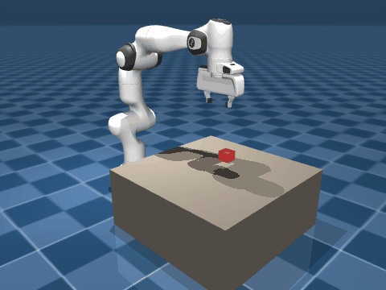

# Franka Panda 视觉抓取闭环



MuJoCo 环境下的 Franka Emika Panda 七自由度机械臂自主抓取：
**单目相机定位 → 差分 IK 解算 → 阶段表驱动执行**，抓取流程中不读取仿真真值。

| 指标 | 结果 |
| --- | --- |
| 方块定位误差 | 0.8 ~ 2.8 mm |
| 抓取成功率 | 3 / 3（随机位置三回合） |
| 举升高度 | 约 490 mm |

## 快速开始

```bash
pip install -r achievement/requirements.txt
python achievement/ctrl_3G_random.py
```

Windows 下也可以直接双击 `run.bat`。

## 核心代码

只读这两个文件就够了：

| 文件 | 职责 |
| --- | --- |
| [`achievement/perc_1G.py`](achievement/perc_1G.py) | **感知层**。离屏渲染 → 颜色分割 → 质心 → 反投影，输出方块中心的世界坐标 |
| [`achievement/ctrl_3G_random.py`](achievement/ctrl_3G_random.py) | **控制层与主流程**。随机投放方块 → 观察位拍照 → 视觉定位 → 高位垂直下降 → 夹取举升 |

## 工作原理

### 感知：颜色负责「在哪」，先验负责「多远」

1. `mujoco.Renderer` 从俯视相机取一帧 256×256 的 RGB
2. 色度判据分割红色方块：`R - max(G, B) > 40`。比绝对阈值更抗光照——顶面被光洗白、侧面落进阴影都能稳定命中
3. 顶面关于中心竖轴对称，所以 mask 的质心就是中心轴的投影，直接对像素坐标取均值
4. 俯视且方块高度恒定时，相机到顶面的距离 `d` 是常数，反投影退化成线性映射：

   ```
   f = (H / 2) / tan(fovy / 2)
   x = cam_x + (u - cx) * d / f
   y = cam_y - (v - cy) * d / f     # v 轴朝下，取负
   ```

   因为 `d` 已知，连深度图都不用渲染。

5. 抓取点 = 顶面中心 + 竖直偏移

### 控制：阶段表 + 差分 IK

- **IK**：`mink` 的 `FrameTask` 锁定末端位姿，`quadprog` 求解，配合 `ConfigurationLimit` 保证关节限位
- **恒速移动**：步数 = 距离 / (速度 × dt)，插值逐帧下发 `ctrl`，速度与距离无关
- **阶段表**：`Phase(target, grip, wait, R)` 把「去哪、夹爪开合、等多久、什么姿态」压成一行，主循环只管遍历
- **观察位**：每回合先把机械臂撤出相机视锥再拍照，解决「手爪悬在方块正上方」的遮挡
- **高位垂直下降**：先到目标正上方再竖直落下。若从观察位直接斜插过去，张开的手指会像扫帚一样把方块推开约 29 mm

## 文件说明

`achievement/` 下另有 `ctrl_1G / 2G / 3G` 等早期版本，记录了从「单次 IK」到「循环 IK + 阶段表」的演进过程；仓库根目录还有一些学习期的演示脚本（FK 对拍、轨迹插值、四元数解读等）。它们不属于本项目主线，代码风格与完成度不一，仅作过程记录保留。

## 已知限制

- 相机必须正上方俯视，且依赖「方块高度恒定」，深度才能当常数处理
- 单一颜色阈值，只支持红色方块；多目标与相互遮挡未处理
- 未做手眼标定，相机外参直接取自 `model.cam_pos`（仿真的红利）

下一步计划：斜视机位 + 深度图 + 世界点云高度过滤，解除「相机必须在正上方」的机位限制。

## 许可

`franka_emika_panda/` 目录取自 [MuJoCo Menagerie](https://github.com/google-deepmind/mujoco_menagerie)，采用 Apache-2.0 许可。
